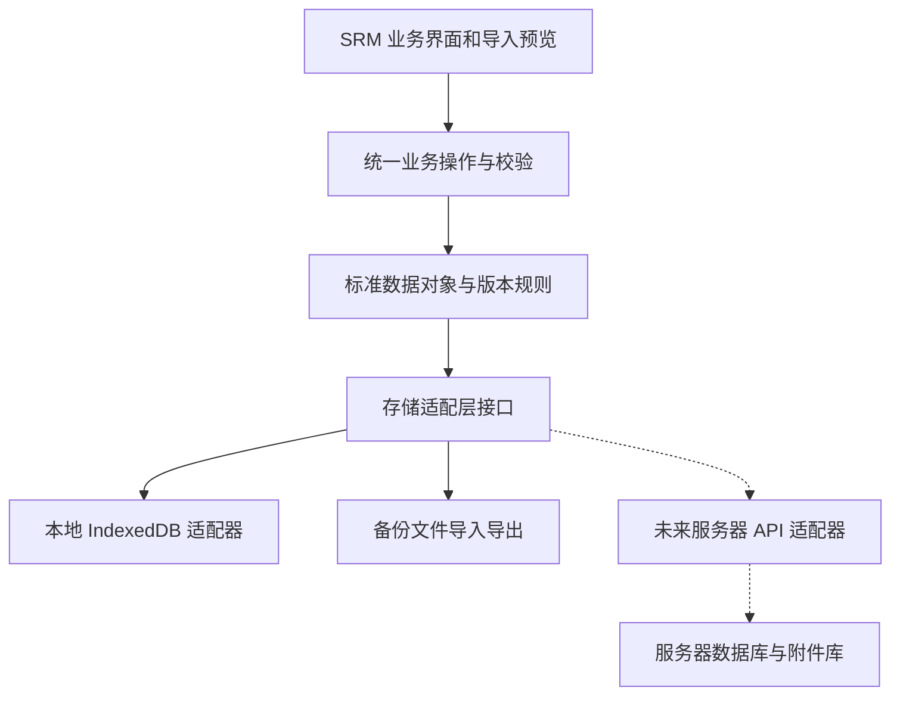

# 20261010 M1 本地数据保存、备份恢复及未来服务器迁移方案（架构已确认）

> <sub>M1 Offline Persistence, Backup and Future Server Migration Design — Architecture Approved</sub>

**文档性质：方案设计，不是已开发功能。适用分支 `draft/20261009-m1-field-model-plan`。基线为已经用户批准的 M0 `main`，本轮不更改任何程序文件。**

> <sub>This is a design proposal, not implemented software. It applies to the M1 documentation draft branch only; the approved M0 source on main remains untouched.</sub>

## 一、结论与技术路线

> <sub>1. Proposed architecture and scope</sub>

**推荐方案：在 M1 保留单机离线 HTML；以稳定业务数据模型 + 存储适配层为核心，浏览器 IndexedDB 仅作为受支持环境下的本机自动保存机制；将版本化 JSON 导出、恢复作为必须交付的便携备份能力。未来由服务器数据库和受权限控制的 API 替换存储适配层，尽量复用业务规则与字段模型。**

> <sub>Recommended: keep M1 offline-first, with a canonical domain model and replaceable persistence adapter. IndexedDB supports local saves where verified; portable versioned JSON backups are mandatory. A future authenticated server storage/API adapter should reuse the same domain logic.</sub>

**已获用户确认：M1 采用单机离线保存 + 手动备份恢复，未来迁移服务器。** IndexedDB 仅在实测浏览器支持时用于自动保存；本轮先制定任务书，不实现代码、自动 NAS/OneDrive 写入、服务器 API 或账号管理。离线自动保存不等于跨设备备份。

> <sub>The user approved single-user offline storage with manual backups and later server migration. IndexedDB autosave remains conditional on browser verification; no code, scheduled backup or server API is implemented in this documentation step.</sub>

## 二、为什么要改：M0 已核实的现状

> <sub>2. Current M0 findings</sub>

M0 在 `prototype/m0/index.html` 内初始化了 1,200 条虚构存货、24 家虚构供应商；`items`、`suppliers`、`assignments: Map`、`quoteRounds: Array`、`awards: Map`、`awardReasons: Map`、`rfqSupplierPool: Set` 等业务状态均在页面运行内存中。源码未使用 IndexedDB、localStorage 或 sessionStorage 保存这些业务对象。

> <sub>The current HTML seeds 1,200 synthetic items and 24 suppliers. Core business state lives in in-memory arrays, Maps and Sets. The page does not persist them through IndexedDB or browser storage.</sub>

M0 的漏报/共同报价 CSV 只导出局部结果。**关闭页面、刷新或更换电脑不能据此恢复完整询价业务状态；不可将 M0 演示初始化数据直接迁移为真实采购记录。**

> <sub>Existing CSV downloads contain partial reports only. They do not restore a complete RFQ, and the built-in demo seed must never become production purchasing data.</sub>

## 三、总体设计：业务逻辑与保存位置分离

> <sub>3. Separate domain logic from storage</sub>



建议统一数据读写接口，例如 `loadWorkspace()`、`commitBusinessOperation()`、`exportBackup()`、`validateAndRestoreBackup()`。界面不直接操作不同数据库的原始表，所有保存都先经过身份、业务状态、引用关系及历史不可覆盖校验。上述是接口设计示意，不是当前已存在的函数。

> <sub>Proposed interface boundaries include loading workspaces, committing validated business operations, exporting backups and validating restores. UI code should not directly depend on a specific database; these are proposed interfaces, not implemented functions.</sub>

数据对象使用**稳定业务 ID** 和明确的 `schemaVersion`。`RFQ Line ID` 与 ERP `存货编码` 独立；往来单位以 `往来单位编码` 定位，`供应商编码` 独立保留为供应商身份编码，允许与往来单位编码不同；同一往来单位可同时是客户和供应商。

> <sub>Use stable business identifiers and an explicit schema version. RFQ Line ID differs from the ERP item code; counterparty identity differs from its supplier-role code, and dual roles are supported.</sub>

首次迁移应将 M0 内存 `Map`、`Set` 转换为 JSON 兼容的规范记录数组或键值对象；恢复时校验并重建集合。不能直接 `JSON.stringify(new Map())` 当成完整备份，它不会保存 Map 条目。

> <sub>Serialize Maps and Sets explicitly to canonical JSON-compatible records and reconstruct them on load. Plain JSON.stringify(Map) would lose their entries.</sub>

## 四、M1 哪些数据需要保存

> <sub>4. Durable data versus temporary interface state</sub>

| 类别 | 保存规则（建议） | 说明 |
| --- | --- | --- |
| 存货主档（ERP 模板字段） | 保存已导入的来源批次与经核实字段 | ERP 存货源字段与 RFQ 临时覆盖值分开 |
| 往来单位与供应商身份 | 保存主体、身份及映射 | 客户和供应商可共存，两个编码独立 |
| RFQ、RFQ 第 N 版、询价行 | 保存、可追溯 | 不修改已发布历史快照 |
| 供应商分配与当轮应报范围 | 保存 | 多对多、覆盖小于 100% 允许，确认快照不可默默变化 |
| 报价轮次、报价版本、有效报价行、阶梯价 | 保存、不可覆盖确认记录 | 不能把漏报或未报写作零元报价 |
| 询价/报价来源证据索引 | 保存引用、来源、校验摘要（如适用） | 不等于保存了原始邮件或 PDF 的文件本体 |
| 定标供应商、非最低价理由、复核状态 | 保存 | 继续报价不能清除人工决策历史 |
| 字段映射、导入批次和业务变更日志 | 保存 | 能追查哪次导入修改了哪些对象 |
| 搜索字词、页码、勾选临时行、弹窗状态 | 默认不作为业务备份 | 可作为临时偏好；不可误恢复旧的未确认导入 |
| 预览中的报价粘贴或待确认批量导入 | 默认仅临时保存 | 用户点击正式确认且通过校验后才落库 |

需要区分**草稿**、**已发布 RFQ**、**已确认供应商报价**、**已作废历史**。已确认内容不能原位覆盖，删除应采用保留历史的作废/停用处理；本地数据库的“更新数据”仅指安全的草稿编辑或追加新版本。

> <sub>Separate drafts, issued RFQs, confirmed quotes and voided history. Confirmed business records must not be silently overwritten; revisions and soft invalidation preserve history.</sub>

## 五、本地保存运行方式和限制

> <sub>5. Offline runtime and limitations</sub>

**首选本地自动保存：** 在浏览器明确支持的环境下，由 IndexedDB 保存结构化业务数据，每次用户确认重要业务操作后进行原子事务提交；只有保存成功才提示“已保存”。对容量不足、禁止存储、无权限、浏览器关闭等情况必须显式报错，不能假装成功。

> <sub>When supported, IndexedDB saves structured data in atomic transactions after validated user actions. The UI must acknowledge a save only after the transaction commits, and must surface quota or storage failures.</sub>

**`file://` 特别限制：** 用户习惯双击 HTML，且此前在 ZIP 临时解压目录打开。不同浏览器或不同文件路径对本地存储的隔离、权限与清理行为可能不同；不能承诺把 ZIP 换个位置打开会读到原数据。M1 必须实测 Windows Edge/Chrome 在固定文件位置打开、刷新、重启以及更换路径后的效果，记录支持情况。

> <sub>The user often opens extracted HTML from temporary file locations. Browser origin/path storage behavior may differ. Test a stable local path, refresh, browser restart and a moved/copy path in Edge/Chrome before claiming IndexedDB durability.</sub>

**降级模式：** 环境不支持可靠自动保存时，界面明显标为“未启用自动保存／仅当前会话”；必须允许手动导出备份并确认用户已取得文件。不能把不可靠的 `localStorage` 当作唯一备份手段，也不能静默把数据丢失归为用户操作错误。

> <sub>If reliable persistence is unavailable, display an explicit session-only mode and keep manual export possible. Never silently claim that localStorage or transient memory is a durable backup.</sub>

**不同电脑不会自动同步。** 用户在公司电脑、家用电脑或不同 Windows 账号之间，需要携带受保护的备份文件手动恢复。避免两个设备各自修改同一个工作空间后互相覆盖；未来需要多人并行时改为服务器共享存储。

> <sub>This is not automatic cross-device sync. Moving between computers requires controlled backup/restore, with explicit conflict protection. Multi-user concurrent editing belongs to the future server architecture.</sub>

**不可自动写到 NAS/OneDrive 文件夹。** 离线 HTML 并无通用的后台文件写入权限，用户下载备份到 OneDrive/NAS 受控目录属于人为完成的备份步骤；若需自动备份，需要另行设计受授权的本地辅助服务或服务器任务。

> <sub>A standalone offline HTML cannot reliably write unattended backups to arbitrary NAS/OneDrive paths. Manual file download is distinct from scheduled automated backups, which require an approved helper or server.</sub>

## 六、可恢复备份文件：版本化 JSON

> <sub>6. Portable versioned JSON backup</sub>

**推荐 M1 首先支持结构化业务数据的完整导出/恢复，不宣称包含原始邮件和大型 PDF 附件。** 默认一个 UTF-8 JSON 文件，包含清晰的格式版本、导出时间、应用版本、工作空间与 RFQ 标识、各业务实体、数据总量、必要的来源与关联关系。文件名使用 `YYYYMMDD_SRM_业务数据备份_vN.json`，避免覆盖旧备份。

> <sub>M1 should export all structured business records, not claim to embed source emails or large PDFs. Use a UTF-8 versioned JSON format with metadata, domain records and relationship information. Never overwrite older backup files.</sub>

```json
{
  "format": "srm-portable-backup",
  "backupFormatVersion": 1,
  "schemaVersion": 1,
  "appVersion": "M1",
  "exportedAt": "2026-10-10T00:00:00Z",
  "workspaceId": "DEMO-WORKSPACE-001",
  "revision": 3,
  "entities": {
    "materials": [],
    "counterparties": [],
    "supplierRoles": [],
    "rfqs": [],
    "rfqRevisions": [],
    "rfqLines": [],
    "assignments": [],
    "quoteRounds": [],
    "quoteRevisions": [],
    "quoteLines": [],
    "priceTiers": [],
    "evidenceReferences": [],
    "awardDecisions": [],
    "importBatches": [],
    "auditEvents": []
  },
  "attachmentsIncluded": false
}
```

上述 JSON **只是匿名结构示意**，字段名和对象划分在编码前还需技术设计，不代表正式 M1 备份格式已发布。未来可增加整包摘要（如 SHA-256）、文件清单和原始附件关联索引，前提是环境支持。

> <sub>This is an illustrative synthetic format only; actual schema keys and checksums require implementation review. Attachment manifests and cryptographic integrity checks may be added with environmental support.</sub>

导出的结构化备份至少应含：RFQ 行身份、物料/供应商主体关系、每个供应商各轮各版、适用阶梯价、原始凭证**路径或标识引用**、人工非最低价原因、历史记录和导入日志。导出前重新核查外键、已确认版本和数量统计；若校验失败，不应给出“完整备份成功”的结论。

> <sub>Backup must include line identities, counterparty mappings, rounds/revisions, tiers, evidence references, manual award rationales and audits. Validate relationships and counts before presenting a successful complete structured-data export.</sub>

## 七、恢复流程（不能直接覆盖现有数据）

> <sub>7. Restore workflow and safety</sub>

1. **选择备份文件 → 只读取不写入 → 解析文件和格式版本。**
> <sub>Select file, parse and check format/version without touching current data.</sub>

2. **独立校验**：对象数量、必填字段、主键唯一性、RFQ Line ID、往来单位编码/供应商身份映射、报价版本引用、阶梯档位、金额与数据类型、安全与完整性约束。
> <sub>Validate counts, unique IDs, cross-entity references, version history, tier structure and typed amounts.</sub>

3. **预览报告**：显示现有工作空间、待恢复工作空间、版本、记录数量、冲突与缺失证据文件清单；用户明确选择“新建独立工作空间”或“替换当前工作空间”。
> <sub>Preview current versus incoming workspace, record counts, collisions and missing external evidence before user choice.</sub>

4. **先建立可回退快照并二次确认**；对结构不兼容、损坏数据、异常引用、升级失败等情况全部拒绝或走明确迁移流程。
> <sub>Create a rollback point, require confirmation and reject invalid/incompatible backups unless a tested migration exists.</sub>

5. **一次事务恢复 → 重新加载核对**；任何失败应保留旧工作空间，不出现“一半导入成功、一半丢失”。
> <sub>Commit the restore atomically; on failure the original workspace must remain recoverable and intact.</sub>

6. **写入恢复审计记录**，注明恢复来源文件名、时间、校验结果、工作空间和操作方式，但日志中不保存真实供应商报价全文。
> <sub>Record restore provenance and results without copying sensitive business values into developer logs.</sub>

新建工作空间与替换工作空间必须分开操作。**禁止静默把另一电脑的旧备份覆盖更新后的报价历史**；如果备份 `revision` 低于当前工作空间，需要强提示并阻止默认覆盖。未来跨设备合并数据是单独的复杂功能，不属于 M1。

> <sub>Restore-as-new and replace-current are separate actions. Prevent overwriting newer confirmed quote history with stale backups; cross-device merge is not part of M1.</sub>

## 八、证据附件与真实文件的边界

> <sub>8. Evidence and attachment retention</sub>

报价来源继续遵守已确认规则：供应商邮件及原附件优先；没有邮件可以使用聊天截图、单独 PDF 等。M1 结构化数据库保存**凭证类型、原文件名、引用位置、来源时间、可能的文件校验摘要与对应报价行关系**；并不因此自动拥有或长期保存这些附件的真实文件内容。

> <sub>Maintain original emails and attachments as preferred evidence, with chat screenshots/PDFs as alternatives. Structured records store evidence metadata and references, not a guarantee that the source binaries are retained.</sub>

建议把正式附件统一存放在受管理的公司文件夹/共享存储中，按 RFQ 编号和供应商建立可追溯路径，配合独立备份。考虑移动电脑、重命名目录可能使外部文件路径失效；恢复流程应明确列出“已恢复元数据，但缺少原始附件”的情况，**不能报告为业务资料完整恢复**。

> <sub>Keep original evidence in approved controlled storage and treat references as separate from binaries. Backup restore must flag missing external attachments rather than claiming complete evidence recovery.</sub>

银行信息子表在 M1 **只保留模型结构**；不读取、导入、备份真实银行账号。完整联系人、多地址及数据协同设置同样不在 M1 首批实际业务保存范围内，后续根据已批准需求增量开放。

> <sub>M1 only reserves banking/contact/collaboration schema relationships; no live bank account or full child-table content ingestion is authorized in the initial release.</sub>

## 九、服务器迁移：避免二次开发的约束

> <sub>9. Future server migration without rewriting business logic</sub>

长期架构建议采用**同一套规范业务对象和校验规则 + 可替换的数据访问层**。M1 本地版由 `IndexedDBAdapter` 实现读写；未来由 `ServerApiAdapter` 发请求，服务器使用具备事务能力的数据库。原始报价证据交由受权限管理的文件服务或对象存储，数据库仅存索引。接口名称是设计示例，暂不创建代码。

> <sub>Keep canonical business entities/validation stable and replace IndexedDB access with an authenticated server API adapter later. Store large evidence files in controlled document/object storage and reference them from the database.</sub>

**迁移工具**：先备份 → 验证 `schemaVersion` → 校验企业主数据映射与角色关系 → 上传/导入服务器的暂存区 → 生成待确认差异报告 → 用户确认后事务性导入 → 抽样核对 RFQ、报价版本、附件引用、人工定标和审计日志。必须支持重复导入识别及回滚，不可直接将 M0 演示数据当成真实资料。

> <sub>A future migration pipeline validates schema, master identities, role mappings and historical links before staged, transactional server import. It should be idempotent, auditable and rollback-capable.</sub>

**服务器上线新增能力**包括统一账号、基于角色的权限、并发编辑冲突检测、服务端事务与访问日志、自动备份/灾难恢复、数据加密与敏感字段控制，以及附件访问授权。这些**不能仅靠离线 HTML + 本地备份实现**。

> <sub>Production server deployment adds authentication, authorization, concurrency control, transactions, backups, recovery, encryption, auditing and evidence access rules. These cannot be simulated as present in offline M1.</sub>

为未来兼容，M1 需预留 `workspaceId`、对象稳定主键、`schemaVersion`、单工作空间修订号以及业务历史版本；避免在业务规则函数中写死浏览器文件路径或 IndexedDB 对象名称。

> <sub>Future compatibility requires stable workspace/entity keys, schema and revision versions, with business rules decoupled from browser paths and object-store names.</sub>

## 十、分阶段落地顺序（建议）

> <sub>10. Proposed delivery sequence</sub>

1. **P0 结构梳理**：建立规范实体、统一数据类型、明确 RFQ/报价版本和往来单位身份；把 M0 虚构演示数据与新建真实工作空间隔离。

> <sub>1. Normalize entities and separate demo seed from user-created workspaces.</sub>

2. **P1 存储抽象 + 保存**：所有变更通过统一业务操作，接入 IndexedDB 支持探测及事务；不支持时明确提示只会话模式。

> <sub>2. Add storage adapters, capability detection and atomic business commits with honest fallback.</sub>

3. **P2 导出及恢复**：JSON 全量结构化备份、预览、版本/引用校验、替换/新建、失败回滚和审计。

> <sub>3. Implement validated portable backup and transactional restore.</sub>

4. **P3 证据关联与健壮性**：原始邮件/PDF 引用管理、缺文件检查、配额异常、路径变化、双标签页冲突与重启测试。

> <sub>4. Harden evidence links and test quota, moved file origins and concurrent tabs.</sub>

5. **P4 服务器迁移准备**：固定兼容协议和数据字典、输出 API/迁移接口草案；暂不要求提供服务器地址或部署环境。

> <sub>5. Freeze compatible schema and server/migration contract, without deploying the server in M1.</sub>

## 十一、必须执行的验收清单

> <sub>11. Acceptance checklist</sub>

- **保存有效性**：新增 RFQ 行、分配供应商、录入并确认报价、填写非最低价原因后刷新/关闭重开，数据身份和数量完整，未重复。

> <sub>Reload preserves saved RFQs, assignments, quote history and award reasons.</sub>

- **历史不可覆盖**：报价确认后不能原位改写或被恢复时静默替换；新增版本保留旧内容。

> <sub>Confirmed quote history is immutable and restorable.</sub>

- **备份正确性**：至少含所有必需结构化实体；文件有格式/数据库版本、记录数量、时间和工作空间 ID；实际下载后用独立解析检查。

> <sub>Portable backup contains the full canonical data model and verifiable metadata.</sub>

- **恢复安全**：正常备份能新建独立工作空间并验证数量；旧版、损坏、缺外键、重复 ID 或坏阶梯价能阻止恢复；失败原有数据不变。

> <sub>Successful restore preserves identities; invalid restore must be atomic and nondestructive.</sub>

- **覆盖防护**：较旧备份不默认覆盖较新的工作空间；需要替换必须醒目提示并显式确认。

> <sub>Stale backup never silently replaces newer data.</sub>

- **本地能力异常**：禁用 IndexedDB、配额不足、隐私模式及临时 ZIP 提取路径变更时可识别限制，不宣称已自动保存。

> <sub>Storage restrictions and moved local origins show honest warnings.</sub>

- **双窗口冲突**：两个标签页同时操作同一工作空间时能检测修订号冲突并阻止后写覆盖前写，不发生静默丢单。

> <sub>Concurrent tabs detect conflicting revisions.</sub>

- **证据边界**：恢复元数据但附件缺失时明确提示，不能报告成原始凭证已全部恢复。

> <sub>Restored references are not misrepresented as recovered binary evidence.</sub>

- **兼容及数据隔离**：旧 M0 50 项逻辑、已有 Playwright 100×10 采购流程继续通过；匿名演示种子不会自动进入正式库。

> <sub>Existing M0 checks remain green and synthetic demo records stay out of production workspaces.</sub>

- **企业数据保护**：真实资料和完整备份不进入 GitHub、Actions artifact、错误日志、截图或公开页面；CI 使用虚构数据。

> <sub>Never leak real business data through source control, CI, logs or screenshots.</sub>

## 十二、已确认的架构和剩余附件决策

> <sub>12. Approved architecture and remaining evidence-storage decision</sub>

**决策 A（用户已确认）：M1 先做单机离线版本，使用“本地自动保存（若环境支持）+ 手动 JSON 备份/恢复”，后续再迁移服务器。** 本阶段不要求多人实时共用数据，不用文件拷贝伪装服务器协作。

> <sub>User-approved: build single-user offline M1 with conditional local autosave and portable JSON backups, then migrate to a server in a future phase.</sub>

**决策 B（可后续确认）：原始凭证附件保管目录。** M1 第一批只保存来源路径/标识及缺件提醒；真实邮件、PDF、聊天截图仍由用户/公司在受控文件夹单独保管。正式附件目录未确定不阻断结构化数据保存模块设计。

> <sub>The precise controlled evidence location can be decided later. M1 first records references and missing-file indicators; original binaries remain separately retained.</sub>

**下一步技术执行：** 已形成 `docs/19_20261010_M1单机离线持久化开发任务书_待执行.md` 和 `docs/20_20261010_M1离线保存与备份恢复自动验收用例_待执行.md`。本轮仅编写文档；后续代码开发使用独立草稿分支，未经再次批准不得合并 `main`。

> <sub>The M1 work order and acceptance cases are now documented. No implementation or merge is authorized by this documentation step; coding will use a separate draft branch.</sub>
