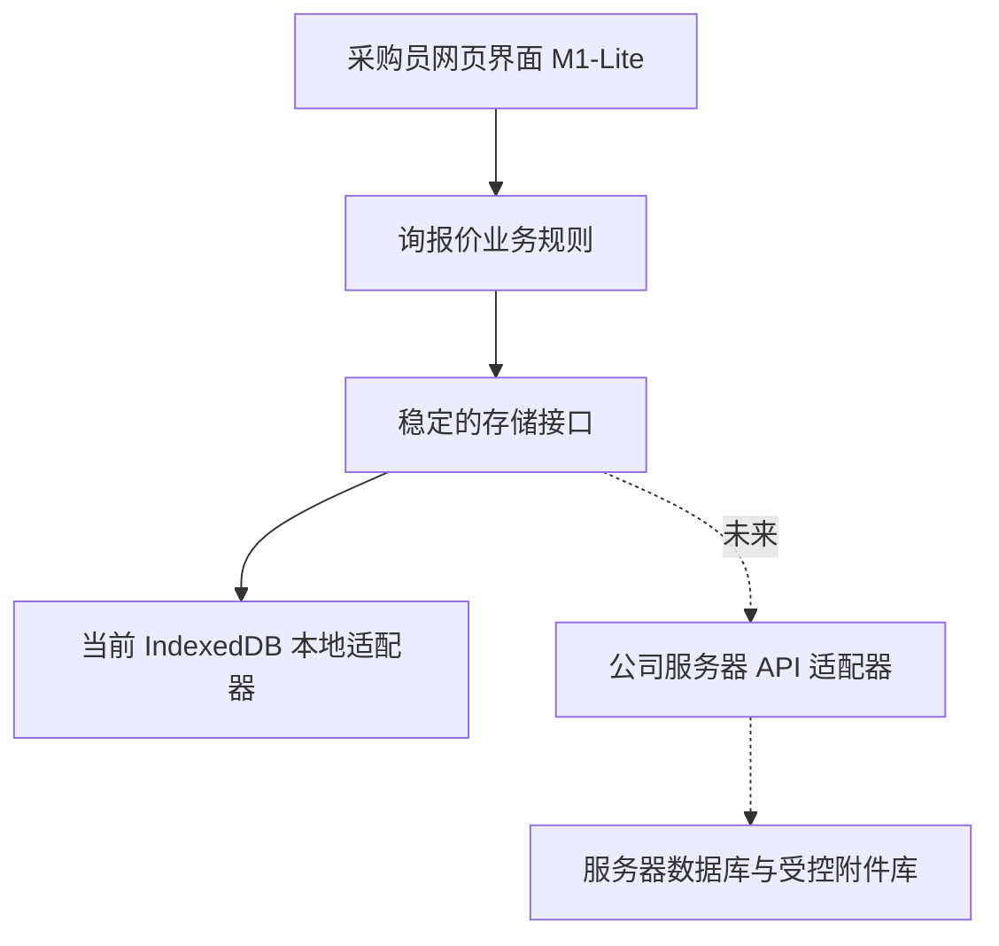

# 20261010 M1-B0 GitHub 案例调研、轻量化收敛与服务器迁移接口方案

> M1-B0 GitHub Reference Review, Lean Scope and Future Server Boundary

**结论：现有 M1 全模型和长期项目计划可以作为远期设计参考，但不能当作首批可用版本的全部验收门槛。首批目标是采购员完成询价、供应商分配、报价导入、同范围比价、保存和备份。**

> The existing comprehensive M1 model is a future reference, not the launch gate. First deliver the buyer's RFQ, assignment, quote capture, comparison, local save and manual backup flow.

## 一、调研方法与可追溯 GitHub 案例

> 1. Public GitHub cases and decisions

### ERPNext

- 源码：https://github.com/frappe/erpnext
- 参考说明：https://docs.frappe.io/erpnext/request-for-quotation
- 借鉴：RFQ 连接多家供应商及物料，供应商报价与采购单据分开管理。
- **本阶段决定：**借鉴 RFQ→供应商覆盖→供应商报价关系和状态，不使用 Frappe 后端/供应商门户。

> ERPNext: ERPNext is a useful process reference, not a backend dependency. It is GPL-3.0; do not copy its source.

### Dexie.js

- 源码：https://github.com/dexie/Dexie.js
- 参考说明：https://dexie.org/docs/Samples
- 借鉴：IndexedDB 的轻量操作、异步事务与升级版本经验。
- **本阶段决定：**B0 优先直接使用浏览器原生 IndexedDB 做能力探测；若 B1/B2 原生维护复杂再评估 Dexie 的体积和 Apache-2.0 许可。

> Dexie.js: Dexie is a possible later dependency, not a requirement today.

### Tabulator

- 源码：https://github.com/tabulator-tables/tabulator
- 参考说明：https://tabulator.info
- 借鉴：对较大表格的过滤、编辑、分页、排序和选择交互有成熟参考。
- **本阶段决定：**先保留 M0 已通过验收的表格和采购员操作习惯，确有性能瓶颈再引入并自包含打包；项目 MIT 许可。

> Tabulator: Adopt interaction ideas now, avoid a grid rewrite for the first release.

### Tabler

- 源码：https://github.com/tabler/tabler
- 参考说明：https://tabler.io
- 借鉴：清楚的业务面板布局、状态提示、响应式密度。
- **本阶段决定：**只借鉴间距、信息层级和状态展示；不整套换 Bootstrap/图表依赖。项目 MIT，附带第三方库的许可必须单独审查。

> Tabler: Reuse UI principles rather than replacing the whole interface.

### PGlite

- 源码：https://github.com/electric-sql/pglite
- 参考说明：https://pglite.dev
- 借鉴：浏览器内运行 PostgreSQL 的完整 SQL 模型。
- **本阶段决定：**现阶段不采用：WASM/体积/迁移复杂度大于轻量询价收益；公司服务器阶段可以另行选择 PostgreSQL，和浏览器 PGlite 没有绑定关系。

> PGlite: Reject in-browser Postgres for M1; a future server may use a conventional server database.

### localForage

- 源码：https://github.com/localForage/localForage
- 参考说明：https://localforage.github.io/localForage
- 借鉴：简化本地存储接口，同时能在浏览器能力不一时回退。
- **本阶段决定：**现阶段不采用静默回退方案，以免 localStorage 容量或事务语义差异被误认为可靠业务持久化。

> localForage: Avoid implicit storage fallbacks that obscure durability limitations.

**版权原则：** 仅借鉴业务模式、公开架构思路与界面交互，不拷贝 ERPNext 等项目源码。任何未来引入的依赖均要记录准确来源、版本、许可证、NOTICE、离线打包方式和安全维护责任，先做合规检查。

> Reference publicly documented ideas only. Any future code dependency requires version/license/notice, offline bundling and maintenance review.

## 二、反思原 M1 方案过重之处

> 2. Areas to simplify

- **原方案：16 类正式实体一次落地。** 新方案：首次只保存必要业务对象：工作空间、往来单位供应商身份、RFQ、RFQ 行、分配、报价轮次与报价行、报价证据引用、人工定标。复杂历史审计、供应商联系人/银行与 ERP 全属性按需再加。

> Implement only the entities needed for the first real purchasing workflow.

- **原方案：220 个 ERP 字段立即开发。** 新方案：220 字段保留来源字典与一致命名原则，首版只导入直接影响询价的核心字段；其他原表字段可作为原始映射信息留存，不要求逐项建设界面。

> Keep the source dictionary but delay full schema UI work.

- **原方案：全套审核/权限/服务器兼容提前完成。** 新方案：M1 只预留业务键与数据访问接口。正式服务器部署时做账号、权限、后端数据库与集中审计，不在离线版模拟。

> Reserve seams for server features without building server permissions in M1.

- **原方案：完全的历史无损升级系统在首版完成。** 新方案：首版要求报价轮次/确认状态不能被静默覆盖，数据备份恢复有明确边界；更多复杂迁移规则按后续真实业务需要扩展。

> Protect confirmed quotation history, defer elaborate migrations.

- **原方案：界面大改和组件引入。** 新方案：继续沿用 M0 验收通过的四大操作流程，只解决妨碍采购员效率的错误、字段不一致和数据保存问题。

> Keep accepted UI flows; avoid cosmetic rewrites.

## 三、首个真正可试用版本：M1-Lite

> 3. Minimal usable M1-Lite release

**优先必须有（M1-Lite）：** 1）创建并保存 RFQ 与拟询价清单；2）管理本次供应商分配；3）回收 Excel/复制粘贴报价（当前 M0 已有的输入流程保持兼容，正式 Excel 解析能力按实际测试逐步确认）；4）多轮报价记录、有效报价/漏报检查、阶梯价、同范围比价与非最低价原因；5）本地保存、手动全量结构化备份/恢复。

> Must-have: RFQ and item list, supplier assignment, quote entry and iterations, completeness and price comparison, award rationale, and dependable local save/export/restore. Keep compatibility with accepted M0 interactions.

**可以延后：** ERP 全量 220 字段维护、历史采购订单批量迁移、供应商联系方式/银行/协同全套表、完整 PDF OCR、OA 审批、多人账号/权限、自动 NAS 备份、服务器部署和整套 UI 框架更换。

> Defer full ERP master management, PO history migration, all related contact/banking/integration tables, universal PDF extraction, OA, multiuser auth, automated NAS backups, server deployment and a full UI rewrite.

**上线速度原则：** 完成一条采购员端到端 RFQ 工作链后尽快小范围试用，再通过真实反馈推进。文档和技术扩展点不应无限增加首次试用的阻断项目。

> Pilot the complete buyer workflow early; architecture optionality must not indefinitely postpone adoption.

## 四、本地与服务器两种运行形态共用的边界

> 4. Stable separation for later company-hosted web deployment

**关键不是提前把服务器建出来，而是避免业务代码直接依赖浏览器存储函数。** 建议 `loadWorkspace`、`saveWorkspace`、`exportBackup`、`restoreBackup` 等精简接口，内部稳定使用 RFQ Line ID、存货编码、往来单位编码和供应商编码。接口名为设计示意，现阶段尚未实现业务存储。

> Avoid direct UI dependence on IndexedDB. Define a minimal adapter boundary around workspaces and durable operations while preserving ERP-aligned identity fields. These are proposed contracts, not implemented business storage.

**公司服务器上线形态（未来）**：部署受 IT 维护的网页应用，员工从公司内部网址打开；服务器集中保存数据与原始凭证，进行用户认证、分角色权限与备份。生产版不会将每位员工的浏览器 IndexedDB 当作最终权威数据库。

> Future deployment: staff access the company-hosted web app by URL. The server owns authoritative data, authentication, access control and backups rather than each user's browser database.

## 五、已执行的 B0 边界

> 5. Current B0 deliverables and remaining browser verification

B0 单独开发分支 `draft/20261010-m1-b0-lean-foundation` 从已批准 `main` 建立。仅新增独立技术检测源码、无依赖单 HTML 构建、自动测试及本文，不触碰 `prototype/m0/index.html`，不插入真实公司资料。

> B0 is isolated in a draft branch based on approved main, adding only a storage probe, reproducible single-file build and tests; existing M0 and real purchasing data remain untouched.

**检测不等于持久化上线。** `src/m1-b0/storage-probe.js` 只写一条虚构临时记录、关闭重开读取并清理数据库。构建脚本输出 `prototype/m1-b0/index.html`；GitHub Actions 必须通过真实 Chromium `file://` 测试。Windows Edge/Chrome、ZIP 临时目录与移动路径行为尚需单独验收。

> The probe writes synthetic temporary data and removes it. CI checks the actual file URL, but Windows browser/origin reliability still needs separate UAT.

**后续 B1 最小目标：** 将 M0 已有的 RFQ/供应商/报价核心状态转换为可序列化工作空间，同时隔离 1200 条演示物料。待 B0 验证后再按用户确认分批开发。

> Next minimal B1 task: canonicalize the existing RFQ/supplier/quotation state and isolate synthetic demo records. Do not implement further stages as part of B0.

## 六、需关注的实际管理风险

> 6. Buyer-facing operational risks

离线阶段必须说明：清理浏览器数据、移动 HTML 路径、临时解压目录、不同电脑/Windows 用户可能造成本地数据不可见；JSON 文件备份不是自动 NAS 备份，原始 PDF/邮件不在结构化备份中；采购员需要清楚看到“已保存”与“已备份”两个不同状态。

> Offline storage can be lost or isolated across file paths, users and browsers. A downloaded structured JSON backup is not automated NAS backup and excludes original evidence binaries; saved and backed-up must be distinct statuses.

