# 原生截图 / Native browser screenshots

真实运行中的候选UI，未编辑。23是Trace Viewer。19/20主要显示自动保存版本，错误行由完整页面文本、trace及字段对比佐证。

## 01-demo-template-entry

## 02-demo-download-feedback

## 03-formal-empty-downloads

## 04-material-template-filled-preview

## 05-two-materials-imported

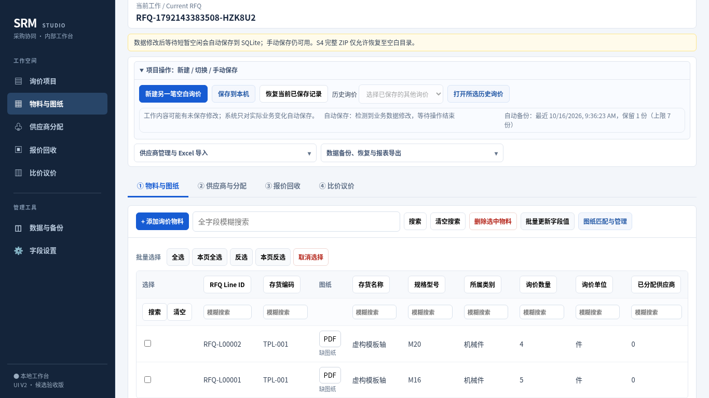

## 06-csv-standard-header-preview

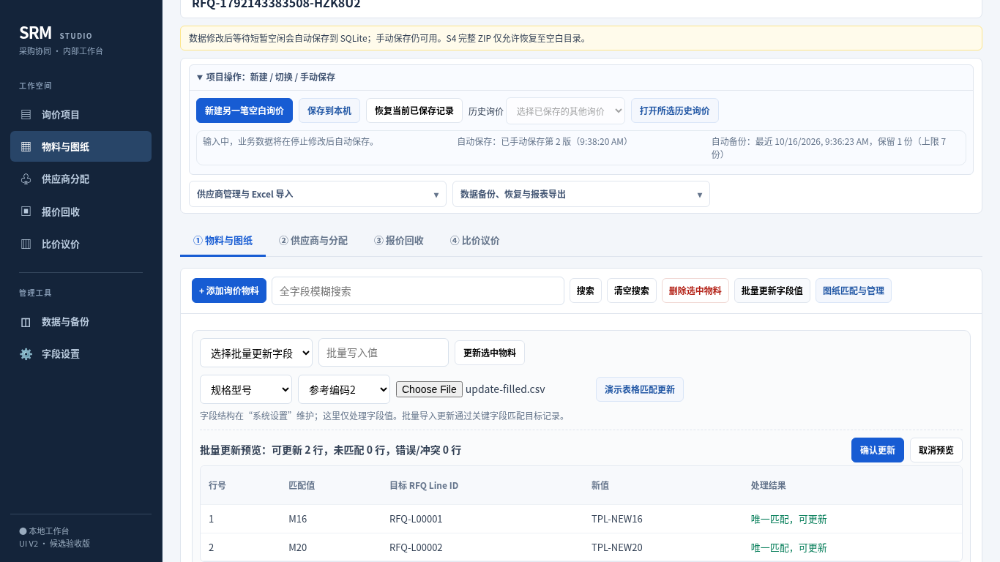

## 07-csv-standard-header-applied

## 08-headerless-csv-applied

## 09-supplier-template-preview

## 10-two-suppliers-fallback-code

## 11-B-downloaded-quote-template-preview

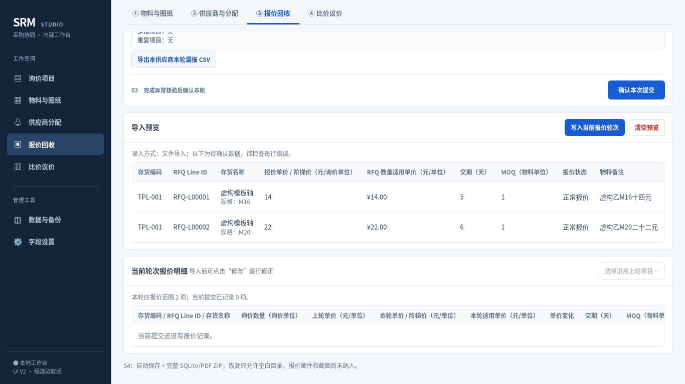

## 12-B-two-prices-confirmed

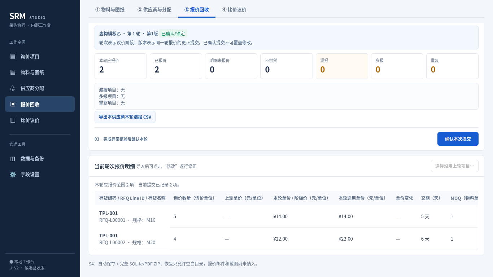

## 13-A-real-template-normal-cannot-preview

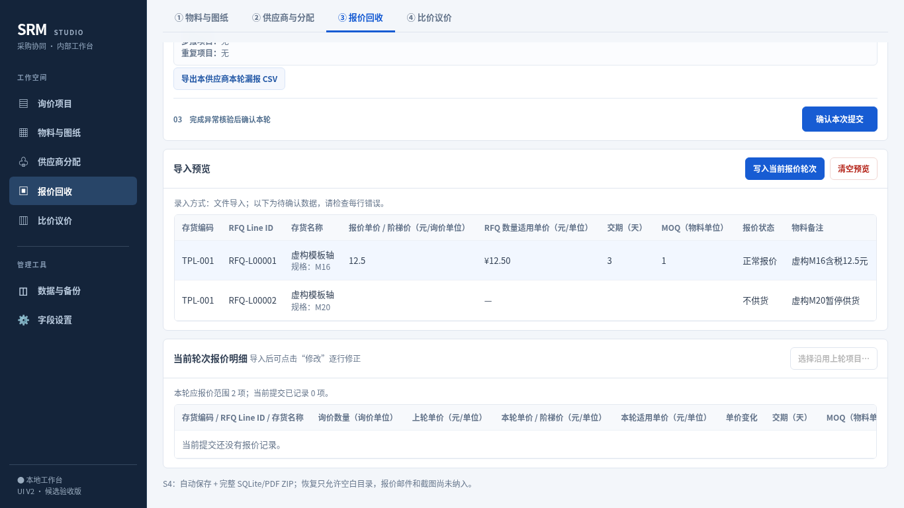

## 14-A-confirmed-normal-cannot

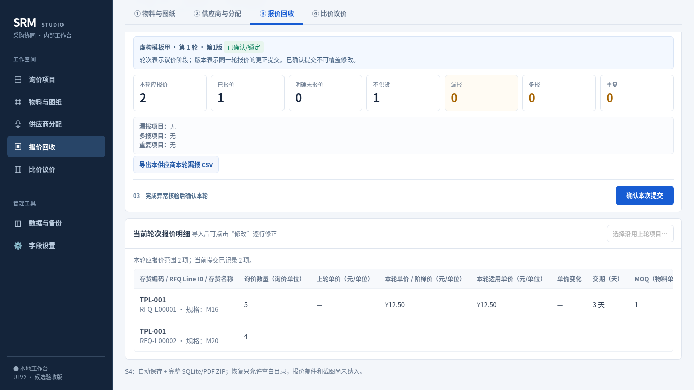

## 15-F3-comparison-status-and-prices

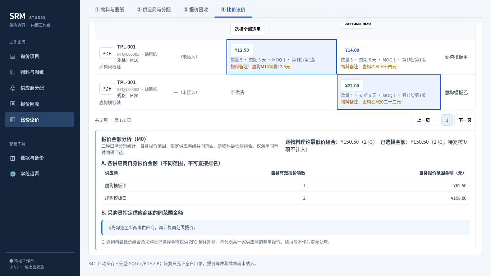

## 16-populated-template-feedback

## 17-F2-scope-specifications

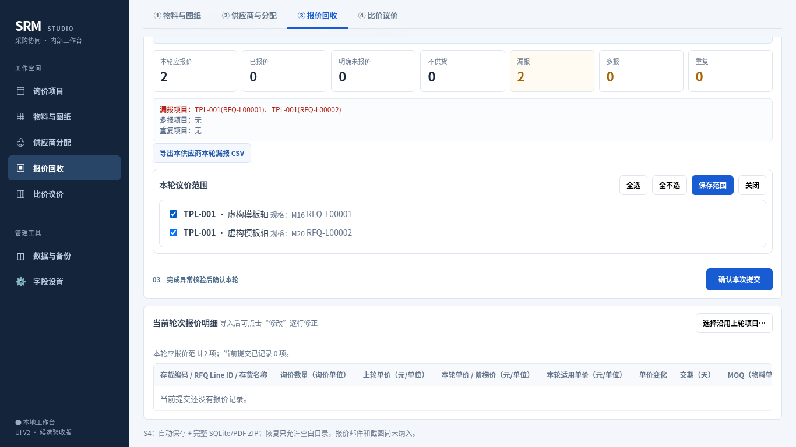

## 18-F2-carry-identity

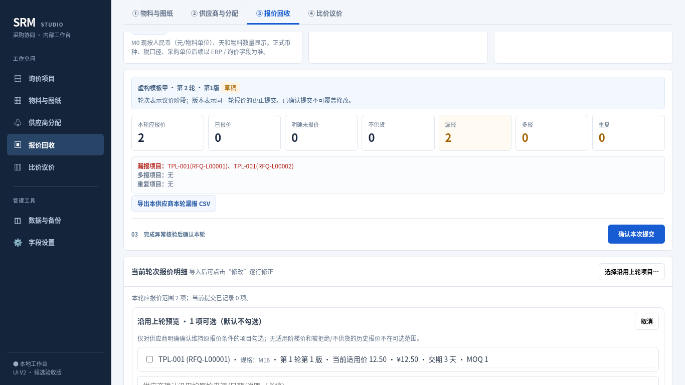

## 19-invalid-preview-advances-save-version

## 20-invalid-preview-auto-save-status

## 21-F1-current-source-id-roundtrip

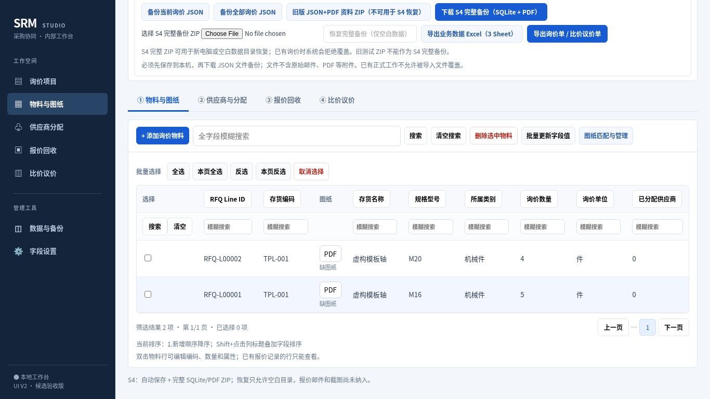

## 22-primary-refresh-persisted-prices-status

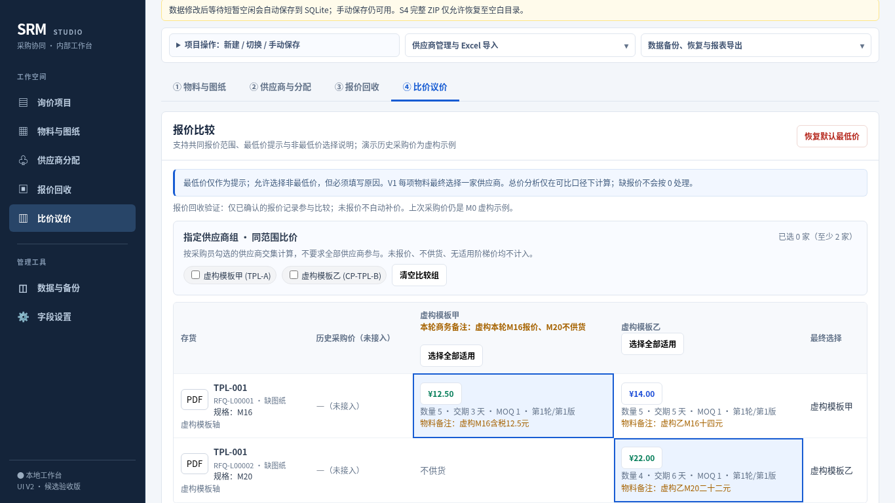

## 23-trace-viewer-validation

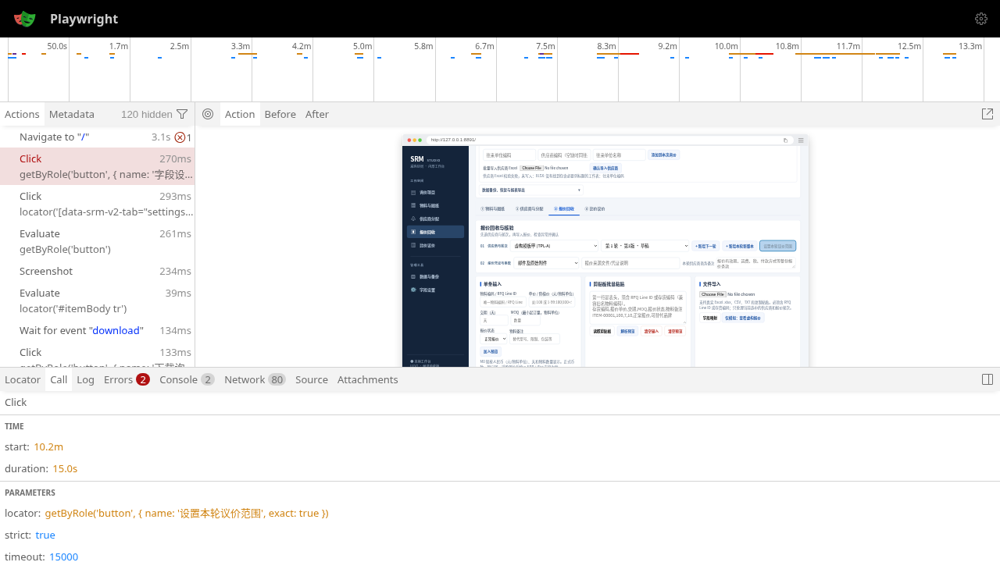

## keyboard-template-focus

## layout-settings-1024

## layout-settings-1366

## layout-settings-1600

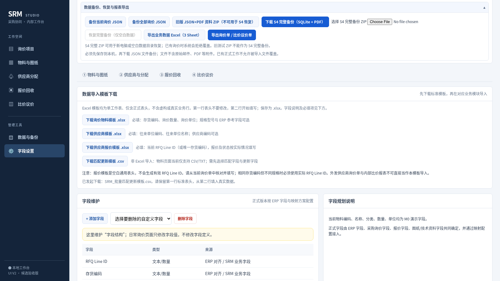

## negative-ambiguous-multisheet

## negative-blank-workbook

## negative-corrupt

## negative-duplicate-heading

## negative-missing-unit

## negative-other-sheet

## negative-wrong-header

## negative-zero-byte

## quote-negative-corrupt

## quote-negative-quote-code-only-ambiguous

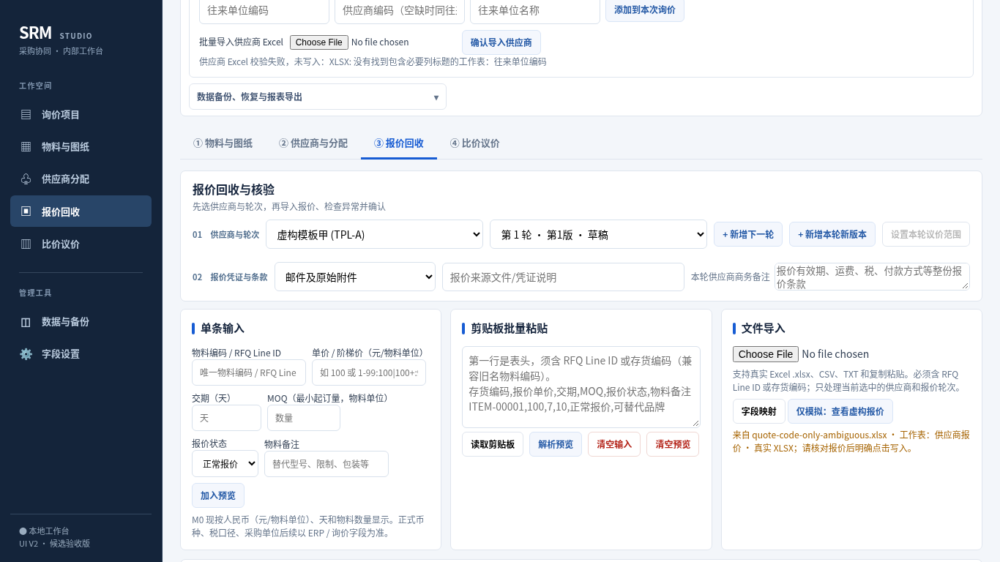

## quote-negative-quotes-wrong-headers

## supplier-negative-supplier-duplicate-existing

## supplier-negative-supplier-duplicate-file

## supplier-negative-supplier-missing-required

## supplier-negative-supplier-wrong-headers

