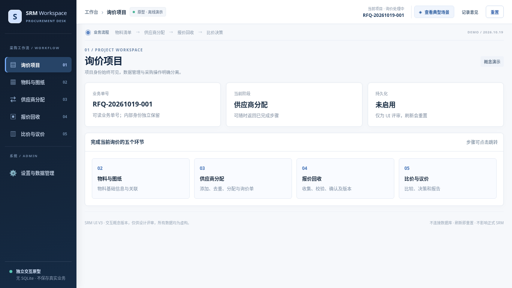
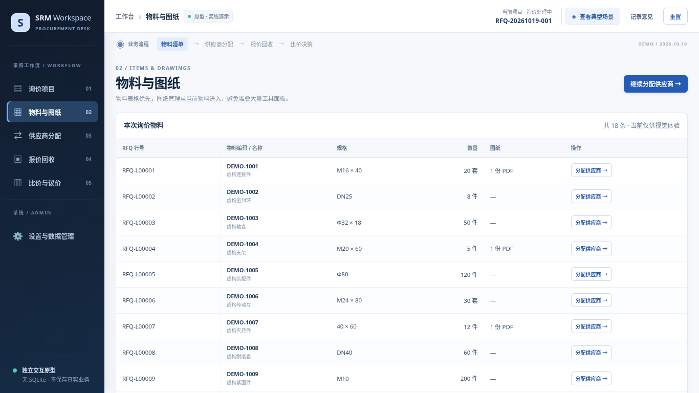
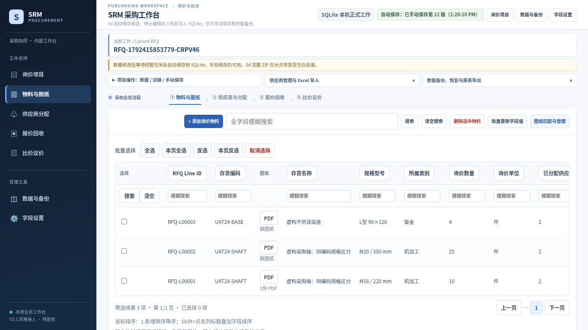
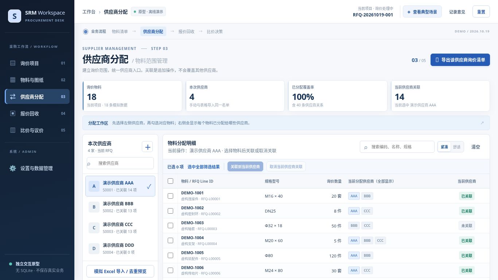
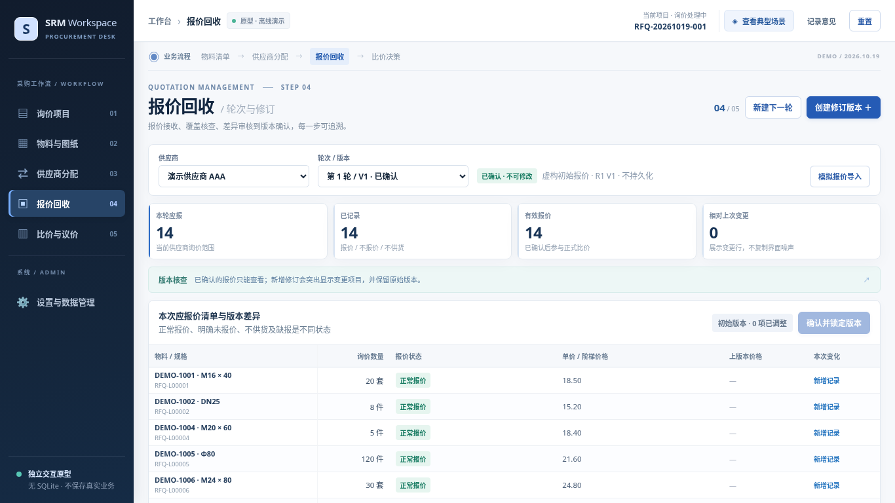
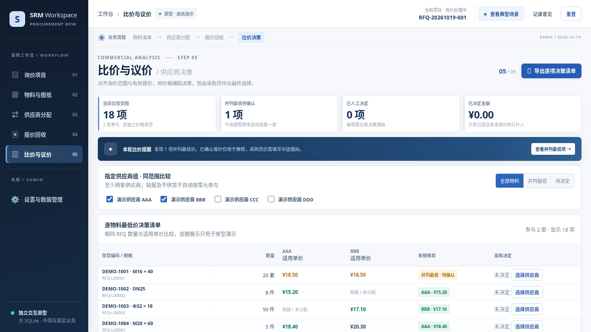
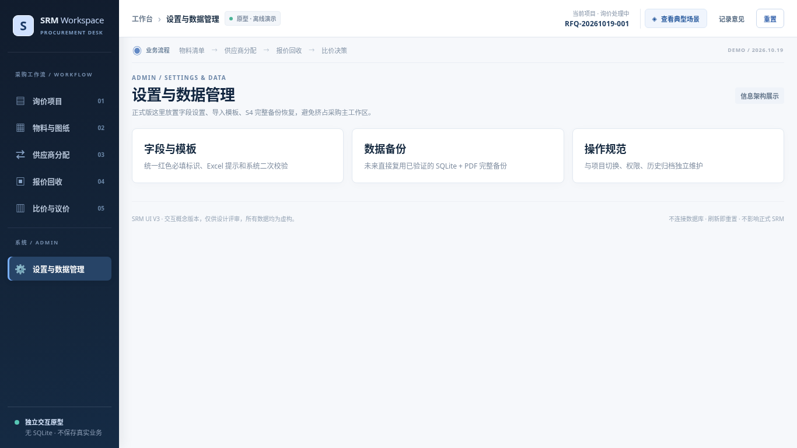
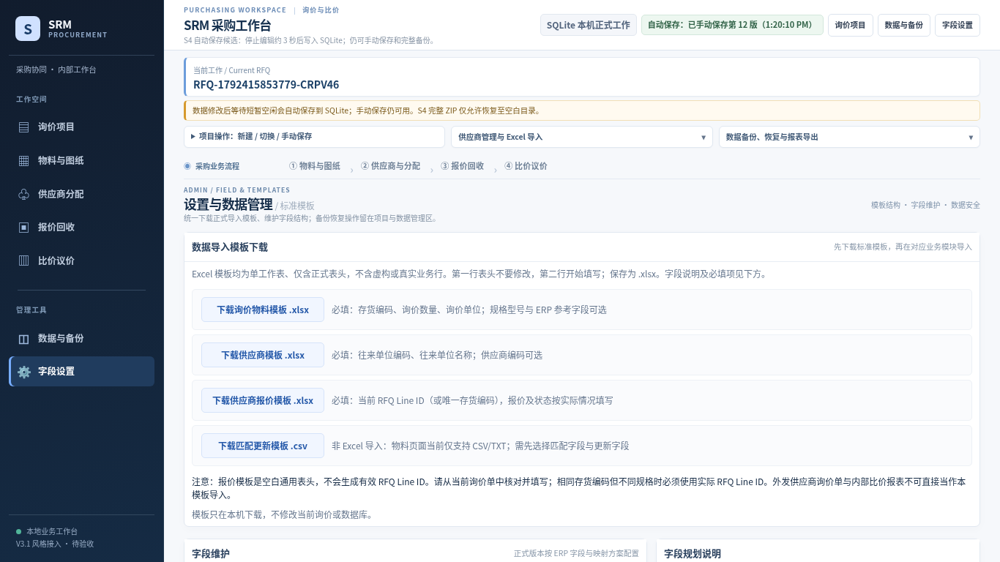
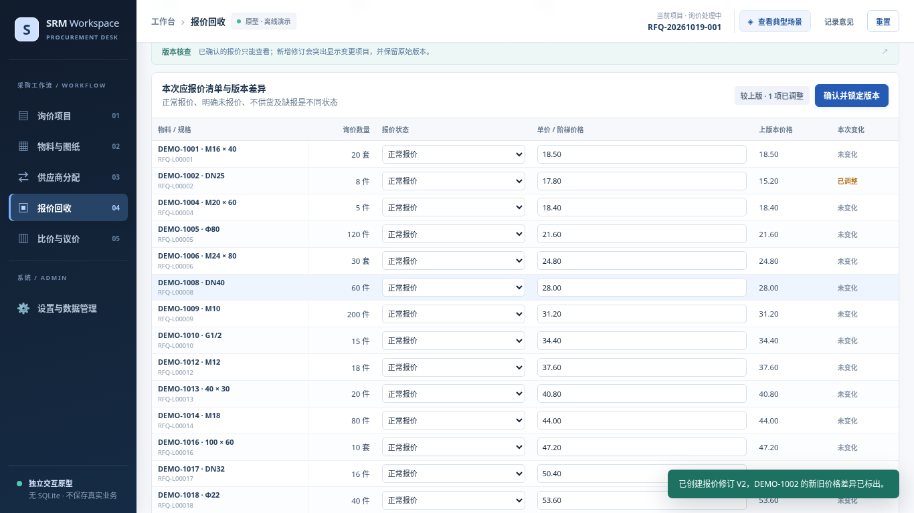
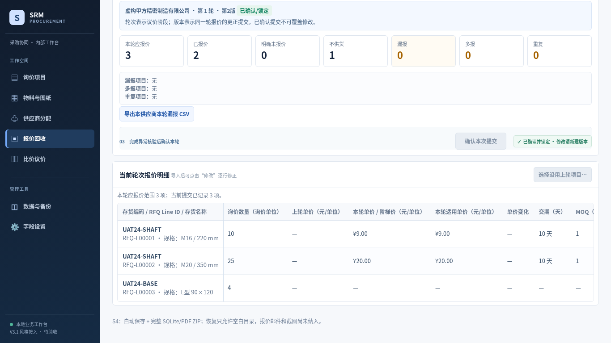

# 逐页截图对照 / Matched viewport captures

左侧为PR23设计参考，右侧为正式候选。不同虚构行数不作为像素对比标准。项目入口/设置深度目标尚为概念，不把模拟控件当真实验收。

## 项目入口 / Project

| 分辨率 | PR23 参考 | PR24 正式候选 |
|---|---|---|
| 1024×768 | [查看](evidence/ref-1024-projects.png) | [查看](evidence/prod-1024-projects.png) |
| 1366×768 | [查看](evidence/ref-1366-projects.png) | [查看](evidence/prod-1366-projects.png) |
| 1600×900 | [查看](evidence/ref-1600-projects.png) | [查看](evidence/prod-1600-projects.png) |

| 1366 设计参考 | 1366 正式候选 |
|---|---|
|  |  |

## 物料图纸 / Items

| 分辨率 | PR23 参考 | PR24 正式候选 |
|---|---|---|
| 1024×768 | [查看](evidence/ref-1024-items.png) | [查看](evidence/prod-1024-items.png) |
| 1366×768 | [查看](evidence/ref-1366-items.png) | [查看](evidence/prod-1366-items.png) |
| 1600×900 | [查看](evidence/ref-1600-items.png) | [查看](evidence/prod-1600-items.png) |

| 1366 设计参考 | 1366 正式候选 |
|---|---|
|  |  |

## 供应商 / Allocation

| 分辨率 | PR23 参考 | PR24 正式候选 |
|---|---|---|
| 1024×768 | [查看](evidence/ref-1024-assign.png) | [查看](evidence/prod-1024-assign.png) |
| 1366×768 | [查看](evidence/ref-1366-assign.png) | [查看](evidence/prod-1366-assign.png) |
| 1600×900 | [查看](evidence/ref-1600-assign.png) | [查看](evidence/prod-1600-assign.png) |

| 1366 设计参考 | 1366 正式候选 |
|---|---|
|  |  |

## 报价 / Quotes

| 分辨率 | PR23 参考 | PR24 正式候选 |
|---|---|---|
| 1024×768 | [查看](evidence/ref-1024-quotes.png) | [查看](evidence/prod-1024-quoteImport.png) |
| 1366×768 | [查看](evidence/ref-1366-quotes.png) | [查看](evidence/prod-1366-quoteImport.png) |
| 1600×900 | [查看](evidence/ref-1600-quotes.png) | [查看](evidence/prod-1600-quoteImport.png) |

| 1366 设计参考 | 1366 正式候选 |
|---|---|
|  |  |

## 比价 / Comparison

| 分辨率 | PR23 参考 | PR24 正式候选 |
|---|---|---|
| 1024×768 | [查看](evidence/ref-1024-compare.png) | [查看](evidence/prod-1024-quotes.png) |
| 1366×768 | [查看](evidence/ref-1366-compare.png) | [查看](evidence/prod-1366-quotes.png) |
| 1600×900 | [查看](evidence/ref-1600-compare.png) | [查看](evidence/prod-1600-quotes.png) |

| 1366 设计参考 | 1366 正式候选 |
|---|---|
|  |  |

## 设置 / Settings

| 分辨率 | PR23 参考 | PR24 正式候选 |
|---|---|---|
| 1024×768 | [查看](evidence/ref-1024-settings.png) | [查看](evidence/prod-1024-settings.png) |
| 1366×768 | [查看](evidence/ref-1366-settings.png) | [查看](evidence/prod-1366-settings.png) |
| 1600×900 | [查看](evidence/ref-1600-settings.png) | [查看](evidence/prod-1600-settings.png) |

| 1366 设计参考 | 1366 正式候选 |
|---|---|
|  |  |

## 同轮修订 / Same-round revision

| PR23 V2 差异 | PR24 V2 旧列结构 |
|---|---|
|  |  |
